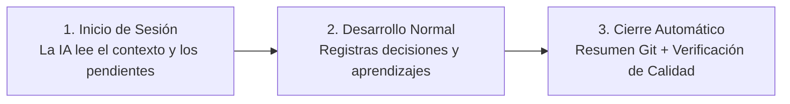

# 🧠 Project Brain
### El Cerebro Persistente y Memoria Universal para tus Asistentes de IA

**Dale memoria a largo plazo a Claude Code, Antigravity, Cursor, Copilot y modelos locales.**  
*Sin amnesia. Sin bases de datos complejas. 100% privado, local y basado en Markdown.*

[Comenzar en 2 Minutos](#-instalación-rápida) • [Por Qué Project Brain](#-el-problema-la-amnesia-de-las-ias) • [Características](#-características-estrella) • [Brain Chat Local](#-brain-chat-tu-chatgpt-local-de-documentación) • [Guía de Instalación](INSTALACION.md)

---

## El Problema: La Amnesia de las IAs

¿Te suena familiar alguno de estos problemas?
- Abres una nueva ventana de chat y tu asistente **ha olvidado por completo** la arquitectura de tu proyecto.
- Tienes que volver a explicarle tu stack, tus convenciones y qué decisiones tomaste ayer.
- Cada asistente toma decisiones contradictorias con las que tomó otra IA horas antes.
- Pasan tres meses y nadie (ni tú ni la IA) recuerda **por qué se implementó una solución de esa forma, qué comando se ejecutó o qué commit la introdujo**.

---

## La Solución: Un "Segundo Cerebro" Compartido

**Project Brain** actúa como la memoria central unificada para todos tus asistentes de IA. No importa si hoy programas con **Claude Code**, mañana usas **Antigravity**, revisas código en **Cursor** o haces consultas offline desde la terminal: **todas tus IAs comparten el mismo cerebro y continúan exactamente donde lo dejó la anterior.**

```
       ┌─────────────────┐   ┌──────────────────┐   ┌─────────────────┐
       │   Claude Code   │   │   Antigravity    │   │  Cursor / IDEs  │
       └────────┬────────┘   └────────┬─────────┘   └────────┬────────┘
                │                     │                      │
                └──────────────┐      │      ┌───────────────┘
                               ▼      ▼      ▼
                        ┌─────────────────────────┐
                        │     PROJECT BRAIN       │
                        │  Memoria en Markdown    │
                        │  + Control de Calidad   │
                        │  + Rastreabilidad Git   │
                        └─────────────┬───────────┘
                                      │
                   ┌──────────────────┴──────────────────┐
                   ▼                                     ▼
        ┌─────────────────────┐               ┌─────────────────────┐
        │  Brain Chat Local   │               │  Grafo Obsidian     │
        │  GPU 115+ tok/s     │               │  Navegación Visual  │
        └─────────────────────┘               └─────────────────────┘
```

---

## Características Estrella

### 1. Memoria Infinita y Multi-Agente
Conecta cualquier asistente de IA en 2 líneas de configuración. Si cambias de herramienta, tu historial técnico, tus decisiones de arquitectura (ADRs) y tus aprendizajes siguen intactos y actualizados.

### 2. Brain Chat: Tu Asistente Local con Aceleración GPU
Una aplicación de escritorio nativa, minimalista y ultra-rápida estilo ChatGPT:
* **Modelo Local Integrado (Qwen 2.5 1.5B)**: Sin enviar tus datos privados a la nube ni pagar por tokens de API.
* **Aceleración por GPU con Vulkan**: Corre a más de **115 tokens/segundo** en tarjetas AMD, NVIDIA e Intel.
* **0 MB de consumo en reposo**: Al cerrar la ventana, libera por completo la memoria VRAM y RAM.
* **Menciones inteligentes con `@`**: Escribe `@mi-proyecto` para enfocar las respuestas directamente en los documentos y notas de ese proyecto.

### 3. Búsqueda Híbrida BM25 en Milisegundos
Pregúntale a tu repositorio técnico: *"¿Cómo configuramos las migraciones de base de datos el mes pasado?"*. El motor BM25 local encuentra la nota exacta, los comandos ejecutados y el commit asociado en menos de 0.05 segundos.

### 4. Blindaje contra Alucinaciones y Fugas de Secretos
* **Contrato de Calidad Mecánico (`QUALITY.md`)**: El sistema analiza automáticamente las notas redactadas por la IA y rechaza textos con frases vagas, suposiciones sin comprobar o secciones vacías (puntuación estricta 0-100).
* **Escáner de Seguridad Pre-Commit**: Bloquea automáticamente cualquier intento de persistir contraseñas, claves privadas o API keys.

### 5. Visualización del Grafo en Obsidian
Abre tu carpeta `Brain` en Obsidian y observa el grafo de conocimiento vivo de todos tus proyectos: qué decisiones dependen de qué aprendizajes y cómo se interconectan los conceptos entre proyectos.

---

## Instalación Rápida

La instalación configura todo automáticamente: entorno Python, modelos locales, aceleración por GPU, atajos de escritorio y adaptadores de IA.

### En Windows (PowerShell)
```powershell
git clone https://github.com/TU-USUARIO/project-brain.git Brain
cd Brain
powershell -ExecutionPolicy Bypass -File .\scripts\install.ps1
```

### En Linux / macOS (Bash)
```bash
git clone https://github.com/TU-USUARIO/project-brain.git Brain
cd Brain
bash scripts/install.sh
```

> 💡 **¿Quieres todos los detalles paso a paso?** Consulta la [Guía Completa de Instalación](INSTALACION.md).

---

## El Flujo de Trabajo en 3 Pasos

Usar Project Brain no interrumpe tu manera de programar; la potencia:



1. **Al iniciar**: Tu IA lee automáticamente la "Capa Caliente" (índice, contexto actual y pendientes) y empieza a capturar la sesión.
2. **Durante el trabajo**: Si tomas una decisión técnica de peso o resuelves un bug difícil, se guarda como decisión (ADR) o aprendizaje con su comando y commit real.
3. **Al finalizar**: Se ejecuta el cierre automático. Brain recopila los commits de Git, redacta el resumen de sesión, valida la calidad mecánica y persiste los cambios.

---

## Caja de Herramientas (CLI)

| Comando | Lo que hace por ti |
| :--- | :--- |
| **`brain-chat`** | Abre el asistente de escritorio local con IA para chatear con tus proyectos. |
| **`brain-ask`** | Responde preguntas sobre el pasado con evidencia histórica y commits (`brain-ask "¿Cómo desplegamos en AWS?"`). |
| **`brain-search`** | Búsqueda ultrarrápida BM25 en todo tu historial técnico. |
| **`brain-init`** | Registra y conecta un nuevo proyecto a tu cerebro en 1 segundo. |
| **`brain-doctor`** | Diagnostica el estado de tus herramientas, modelos y dependencias. |
| **`brain-audit`** | Audita enlaces rotos, notas desactualizadas o proyectos sin indexar. |

---

## Conecta tus Asistentes de IA en Segundos

Project Brain funciona simplemente añadiendo una instrucción a las reglas de tu asistente favorito:

Añade este bloque en tu archivo `.cursorrules`, `CLAUDE.md`, o en las reglas de tu asistente:

```markdown
## Memoria Persistente (Project Brain)
En cada sesión, consulta `$BRAIN_HOME/PROTOCOL.md`.
- Al inicio: Lee la capa caliente del proyecto y ejecuta `python ~/Brain/tools/brain-capture.py --start --slug <proyecto>`.
- Durante: Registra decisiones y aprendizajes con evidencias reales (archivos y commits).
- Al finalizar: Ejecuta `brain-session`, valida con `brain-quality --strict` y persiste con `brain-commit`.
```

---

## Privacidad y Control Total

* **Sin Cloud Propietaria**: Todo vive en archivos locales `.md`. Puedes leerlos, editarlos o moverlos cuando quieras.
* **Sin Vendor Lock-in**: Si una empresa de IA cierra o cambia sus políticas, tu historial de ingeniería sigue siendo tuyo para siempre.
* **100% Offline**: El buscador, el linter, el validador de calidad y el Brain Chat funcionan sin conexión a Internet.

---

## Licencia

Distribuido bajo la Licencia MIT. Consulta `LICENSE` para más información.
